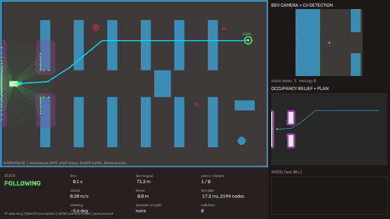
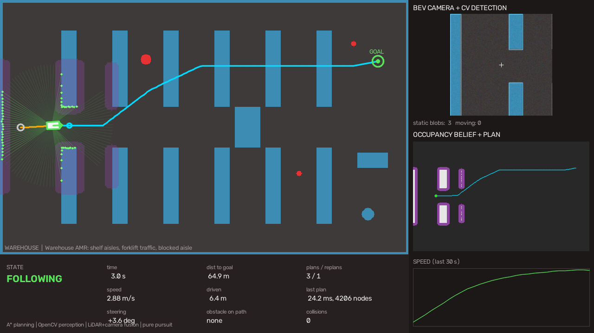
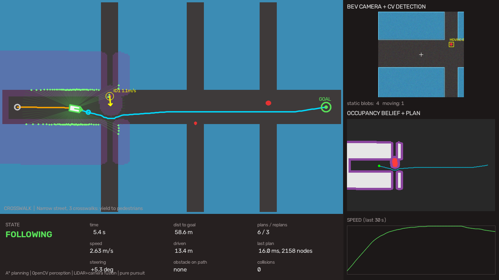
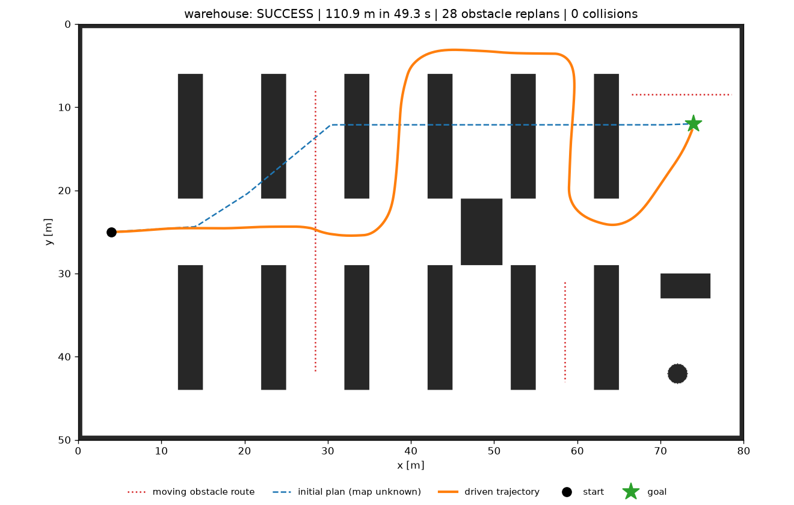
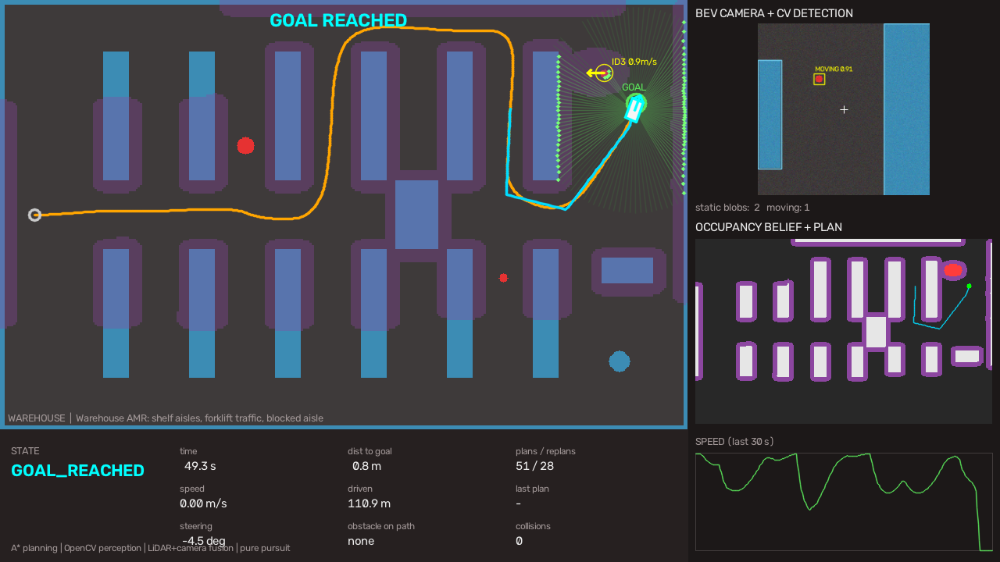
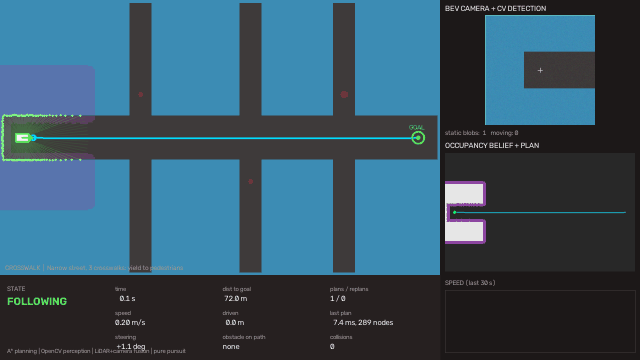
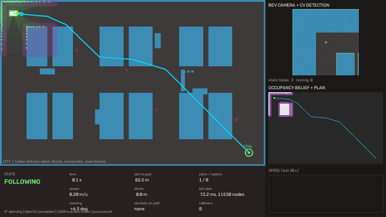
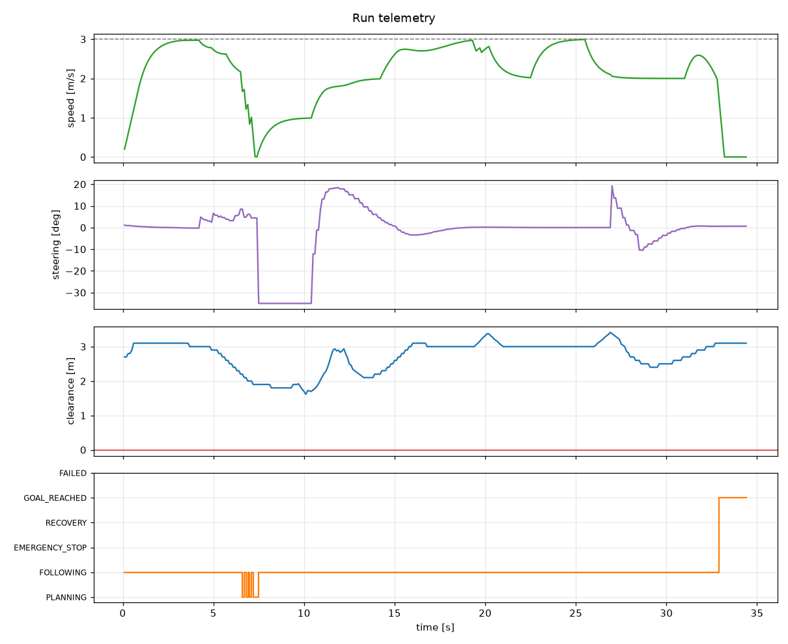
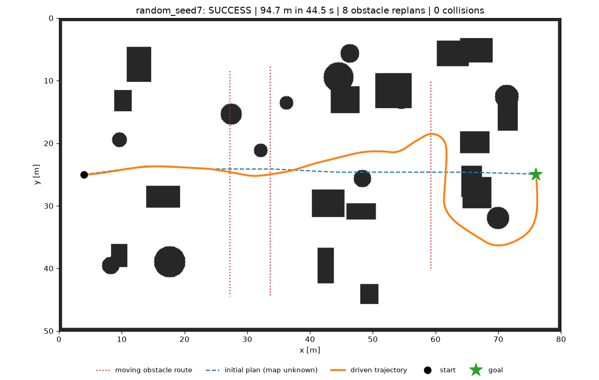
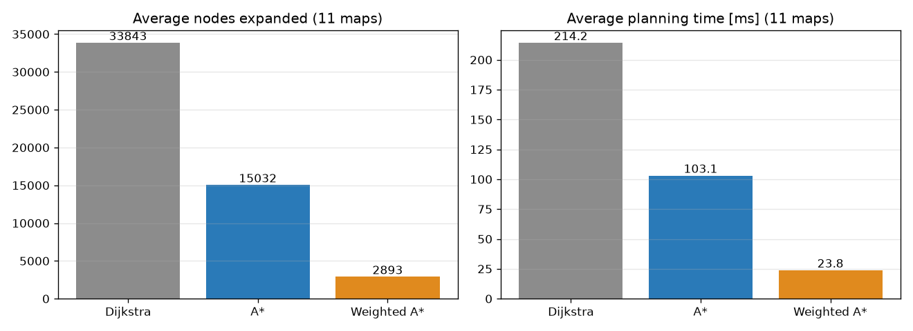

<div align="center">

# 🚗 AI-Based Autonomous Navigation System

**A complete self-driving robot stack: perception, tracking, mapping, path planning, control and safety. Built in Python and tested in a custom simulator. No GPU or hardware needed.**




*Warehouse scenario: the robot starts with **no map**. Its camera discovers a pallet wall blocking the aisle, it **replans** through the top corridor, yields to forklift traffic and reaches the goal.*

</div>

---

## 📌 Key results

| Metric | Result |
|---|---|
| Closed-loop success (A*, 11 maps: warehouse, city, crosswalk, 8 random) | **100 % (11/11)** |
| Collisions (all 33 runs, 3 planners) | **0** |
| Nodes expanded: A* vs Dijkstra (same optimal path) | **−56 %** |
| Planning speed: Weighted A* vs Dijkstra | **~9× faster** |
| Average A* replanning time in the loop (0.25 m grid, 320×200 cells) | **~19 ms** (budget: 100 ms) |
| Automated tests | **20 passing** (unit + end-to-end) |

Full numbers are in [docs/benchmark_results.md](docs/benchmark_results.md).

---

## 🧩 Problem statement
Autonomous mobile robots and self-driving vehicles must reach a goal **safely** in environments that are only **partially known** and contain **moving people and vehicles**. They must:
1. perceive obstacles from noisy sensors,
2. build and update a map,
3. plan a collision-free route,
4. react in real time when the route is blocked or a pedestrian steps in,
5. control a vehicle that can't turn on the spot.

This project implements that full pipeline and proves it works with measurable benchmarks.

## 🏭 Industry relevance
| Domain | Where this pipeline is used |
|---|---|
| Warehouse automation | AMRs (Amazon Robotics, Locus, GreyOrange, Addverb) navigating aisles among workers and forklifts |
| Autonomous vehicles | Perception → prediction → planning → control in Waymo, Tesla, Apollo, Autoware |
| Delivery robots | Sidewalk robots yielding at crosswalks (Starship, Serve) |
| Industrial safety | Driverless forklifts and AGVs with LiDAR protective fields (ISO 3691-4) |
| Drones and smart mobility | Obstacle avoidance and route planning |

The building blocks (inflated costmaps, A*, pure pursuit, tracking with constant-velocity prediction, emergency-stop fields, recovery behaviours) are the same concepts used in **ROS 2 Nav2** and **Autoware**.

---

## ✨ Features
- 🛰️ **Simulated sensors:** 360° 2D LiDAR (120 beams, 12 m, noisy) and a bird's-eye-view camera (240×240 px).
- 👁️ **Computer vision:** OpenCV HSV segmentation, morphology and contour detection that separates static structure from moving objects.
- 🎯 **Multi-object tracking:** persistent IDs, velocity estimation and 2-second motion prediction.
- 🗺️ **Occupancy mapping and sensor fusion:** LiDAR ray tracing plus camera evidence. Moving objects are never written into the static map.
- 🧭 **Path planning:** A*, Dijkstra and Weighted A* on an inflated costmap with soft cost, line-of-sight smoothing and heading-aware planning for a car.
- 🧠 **Decision making:** finite-state machine (FOLLOWING, EMERGENCY_STOP, RECOVERY, GOAL_REACHED) with four replanning triggers and replan hysteresis.
- 🛑 **Safety layer:** LiDAR corridor check with a speed-dependent stopping distance, caution speed near people, and reverse/give-way recovery.
- 🎮 **Control:** pure pursuit with a speed-adaptive lookahead and a curvature-aware speed profile, on a kinematic bicycle model.
- 📊 **Visualisation:** live 1280×720 dashboard, MP4/GIF recording, trajectory and telemetry plots, CSV/JSON metrics.
- ✅ **Engineering:** 20 pytest tests, benchmark suite, one-file config, typed dataclasses, CLI.

---

## 🛠️ Tech stack
| Layer | Tools |
|---|---|
| Language | Python 3.10+ |
| Numerics | NumPy (vectorised ray casting, grid ops) |
| Computer vision | OpenCV (HSV, morphology, contours, dilation, distance transform, video) |
| Plotting | Matplotlib |
| Testing | pytest |
| Algorithms | A*, Dijkstra, Weighted A*, occupancy grid mapping, nearest-neighbour tracking, pure pursuit, bicycle model |

---

## 🏗️ Architecture

```
 ┌──────────── SIMULATOR (ground truth, referee) ────────────┐
 │ World 80×50 m · static obstacles · moving people/forklifts │
 │ Robot: kinematic bicycle model                             │
 └──────────────┬────────────────────────────▲────────────────┘
                │                            │ accel, steer
        ┌───────▼────────┐                   │
        │ SENSORS        │ LiDAR + BEV camera (noisy)
        └───┬────────┬───┘                   │
            │        │                       │
            │  ┌─────▼────────────┐          │
            │  │ OpenCV DETECTOR  │──► static mask / moving objects
            │  └─────┬────────────┘          │
            │  ┌─────▼────────────┐          │
            │  │ TRACKER + 2 s    │──► IDs, velocity, predicted paths
            │  │ PREDICTION       │          │
            │  └─────┬────────────┘          │
        ┌───▼────────▼──────────┐            │
        │ OCCUPANCY GRID        │ sensor fusion (static + dynamic layers)
        └───────────┬───────────┘            │
        ┌───────────▼───────────┐            │
        │ COSTMAP (inflation)   │            │
        └───────────┬───────────┘            │
        ┌───────────▼───────────────────┐    │
        │ NAVIGATOR (state machine)     │    │
        │  A* plan → smooth → safety    │    │
        │  corridor → replan / recover  │    │
        └───────────┬───────────────────┘    │
        ┌───────────▼───────────┐            │
        │ PURE PURSUIT + SPEED  │────────────┘
        └───────────────────────┘
```
Module details, data flow and the state machine are in [docs/ARCHITECTURE.md](docs/ARCHITECTURE.md).

---

## 📁 Folder structure
```
ai-autonomous-navigation-system/
├── main.py                       # CLI entry point: run scenarios
├── requirements.txt              # dependencies
├── src/
│   ├── config.py                 # every tunable parameter, in one place
│   ├── simulation/
│   │   ├── world.py              # ground-truth map, static + moving obstacles
│   │   ├── robot.py              # kinematic bicycle model
│   │   ├── sensors.py            # LiDAR ray casting + BEV camera
│   │   ├── scenarios.py          # warehouse, city, crosswalk, random maps
│   │   └── simulator.py          # main loop, collision referee, output files
│   ├── perception/
│   │   ├── obstacle_detector.py  # OpenCV detection pipeline
│   │   ├── tracker.py            # multi-object tracking + motion prediction
│   │   └── occupancy_grid.py     # mapping + LiDAR/camera fusion
│   ├── planning/
│   │   ├── costmap.py            # inflation + soft cost
│   │   ├── astar.py              # A* / Dijkstra / Weighted A*
│   │   └── smoothing.py          # shortcutting + resampling
│   ├── navigation/
│   │   └── navigator.py          # decision-making state machine + safety layer
│   ├── control/
│   │   └── pure_pursuit.py       # path tracking + speed profile
│   └── visualization/
│       ├── dashboard.py          # live 1280×720 dashboard
│       └── plots.py              # trajectory + telemetry figures
├── scripts/
│   ├── benchmark.py              # planner comparison + closed-loop benchmark
│   └── export_assets.py          # regenerate README GIFs/screenshots
├── tests/                        # 20 pytest tests (unit + integration)
├── docs/                         # guides: architecture, setup, simulation, GitHub, career
├── assets/                       # GIFs and images used in this README
└── outputs/                      # generated per run (git-ignored)
```

---

## ⚙️ Installation
```bash
git clone https://github.com/SNischayPrasad/ai-autonomous-navigation-system.git
cd ai-autonomous-navigation-system
python -m venv .venv
# Windows:  .venv\Scripts\activate        macOS/Linux:  source .venv/bin/activate
pip install -r requirements.txt
pytest -q                                  # → 20 passed
```
Step-by-step instructions for Windows, macOS and Linux are in [docs/SETUP_AND_RUN.md](docs/SETUP_AND_RUN.md).

## ▶️ How to run
```bash
python main.py                                   # warehouse demo with live window (q = quit, p = pause)
python main.py --scenario crosswalk              # yielding to pedestrians
python main.py --scenario all --headless --gif   # every scenario, saves MP4 + GIF + plots
python main.py --scenario random --seed 42       # a new random map
python main.py --planner dijkstra                # compare planners
python scripts/benchmark.py                      # full benchmark → outputs/benchmark/
```
Each run writes `run.mp4`, `trajectory.png`, `telemetry.png`, snapshots, `metrics.json`, `telemetry.csv` and `run.log` to `outputs/<scenario>/`.

---

## 🔁 Simulation workflow
1. **World:** a scenario builds an 80×50 m map with static obstacles and moving agents.
2. **Sense:** each 0.1 s the robot gets a noisy LiDAR scan and a BEV camera image.
3. **Perceive:** OpenCV detects obstacles, the tracker estimates people's velocities, and the occupancy grid fuses everything.
4. **Plan:** the costmap is inflated and A* finds a path. The robot replans when a new obstacle blocks it.
5. **Check safety:** if LiDAR sees something inside the path corridor, the robot stops. If it gets stuck, it recovers.
6. **Act:** pure pursuit computes steering and speed, and the bicycle model moves the robot.
7. **Referee:** collisions and clearance are measured against the ground truth, and outputs are saved.

Details, including how to create your own map, are in [docs/SIMULATION_WORKFLOW.md](docs/SIMULATION_WORKFLOW.md).

---

## 📸 Results and screenshots

| Dynamic replanning (blocked aisle discovered) | Detection + tracking (velocity arrows) |
|---|---|
|  |  |
| **Initial plan vs driven trajectory** | **Goal reached** |
|  |  |

<details>
<summary><b>More: crosswalk and city demos, telemetry, random map, planner benchmark</b></summary>

| Crosswalk: yielding to pedestrians | City: road closure and pedestrians |
|---|---|
|  |  |







</details>

### Planner comparison (fully known maps, 11 maps)
| Planner | Avg time (ms) | Avg nodes expanded | Avg path length (m) |
|---|---|---|---|
| dijkstra | 214.2 | 33843 | 86.2 |
| astar | 103.1 | 15032 | 86.2 |
| weighted_astar | 23.8 | 2893 | 86.2 |

### Closed-loop autonomous runs (unknown map + moving obstacles)
| Planner | Runs | Success rate | Collisions | Avg time to goal (s) | Avg min clearance (m) |
|---|---|---|---|---|---|
| dijkstra | 11 | 100 % | 0 | 43.9 | 1.01 |
| astar | 11 | 100 % | 0 | 40.8 | 1.08 |
| weighted_astar | 11 | 100 % | 0 | 42.1 | 0.94 |

---

## 🚀 Future improvements
- YOLOv8 detector on rendered or real camera images (drop-in replacement for `ObstacleDetector`)
- Kalman-filter tracking with Hungarian assignment
- Hybrid A* / RRT* for kinematically feasible paths, and an MPC controller
- SLAM: remove perfect localisation and add a particle filter or scan matching
- Reinforcement learning (Gymnasium + PPO) compared against the classical stack
- ROS 2 / Gazebo and CARLA bridges, multi-robot fleet, cloud dashboard, drone (3D) version

See [docs/ROADMAP.md](docs/ROADMAP.md).

## 🎓 Learning outcomes
- Designing a modular robotics software architecture with clean interfaces between modules
- Computer vision with OpenCV, and why HSV beats RGB for colour segmentation
- Probabilistic occupancy mapping and multi-sensor fusion
- Graph search (A*, Dijkstra), admissible heuristics, and configuration-space planning
- Vehicle kinematics (bicycle model) and geometric path tracking (pure pursuit)
- Safety engineering: defence in depth, stopping distance, deadlock handling
- Testing and benchmarking robotics software, and turning bugs into regression tests

## 📚 Documentation
| Doc | Contents |
|---|---|
| [PROJECT_GUIDE.md](docs/PROJECT_GUIDE.md) | What the system is, industry use, tech-stack options, phase-by-phase build plan |
| [ARCHITECTURE.md](docs/ARCHITECTURE.md) | Block diagram, modules, data flow, state machine, design decisions |
| [SETUP_AND_RUN.md](docs/SETUP_AND_RUN.md) | Installation (Windows/macOS/Linux), commands, outputs |
| [SIMULATION_WORKFLOW.md](docs/SIMULATION_WORKFLOW.md) | How the virtual simulation works, step by step; proof to capture |
| [CODE_WALKTHROUGH.md](docs/CODE_WALKTHROUGH.md) | File-by-file explanation |
| [GITHUB_GUIDE.md](docs/GITHUB_GUIDE.md) | Publishing, commit strategy, proof checklist |
| [CAREER_KIT.md](docs/CAREER_KIT.md) | Resume bullets, LinkedIn posts, interview Q&A |
| [TROUBLESHOOTING.md](docs/TROUBLESHOOTING.md) | Common errors and fixes |

## 👤 Author
**Sadhanala Nischay Prasad**  
[GitHub @SNischayPrasad](https://github.com/SNischayPrasad)

If you found this useful, please ⭐ the repository.

## 📄 License
MIT. See [LICENSE](LICENSE).
